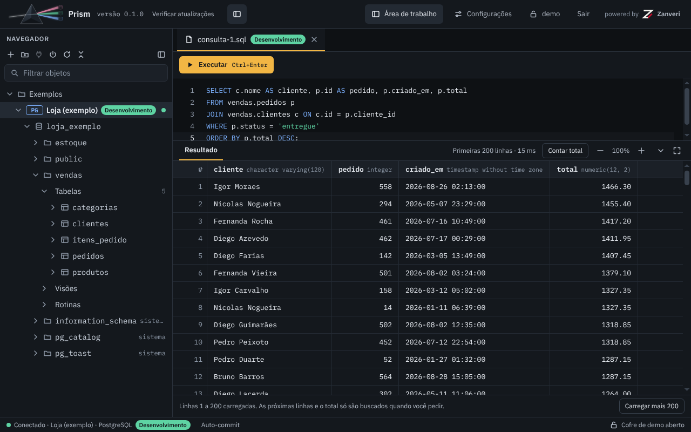

# Prism

[](https://github.com/Zanveri/prism/actions/workflows/pipeline.yml?query=branch%3Adevelop)
[](https://github.com/Zanveri/prism/releases)
[](https://github.com/Zanveri/prism/releases)
[](LICENSE)
[](#baixar)
[](https://zanveri.github.io/prism/)

**[Baixar](https://github.com/Zanveri/prism/releases)** · [Documentação](https://zanveri.github.io/prism/) · [Relatar um problema](https://github.com/Zanveri/prism/issues)

> **Prism** is a desktop database client for people who work every day with Informix, Db2 and PostgreSQL.
> Its goal is to be faster and more direct than DBeaver at the same tasks: open, connect, browse objects, run SQL and see the result.
> It is an Electron app that starts a local ASP.NET Core API on `127.0.0.1`. Each user has an encrypted vault (Argon2id key derivation, AES-256-GCM) with their folders and connections.
> Status: beta. The first public version, [v0.1.0-beta.1](https://github.com/Zanveri/prism/releases/tag/v0.1.0-beta.1), is out. PostgreSQL, Db2 and Informix work; the Db2 and Informix drivers are not bundled: Prism downloads them on demand, under IBM's license. Packages are not code-signed.
> Releases (Windows, Linux and macOS packages) are published on the GitHub releases page of the project, with a `SHA256SUMS` file; every merge into `develop` publishes a beta, and the app offers betas only when "Receive beta versions" is on.
> The documentation is in Brazilian Portuguese: <https://zanveri.github.io/prism/>. License: Apache-2.0.

## O que é e para quem

Prism é um cliente de banco de dados para desktop, no lugar do DBeaver, para quem trabalha todo dia com
Informix, Db2 e PostgreSQL. O critério de sucesso é ser mais rápido e mais direto que o DBeaver nas mesmas
tarefas: abrir, conectar, navegar pelos objetos, rodar SQL e ver o resultado.

É um app Electron (`src/client`, com React e Vite) que inicia uma API ASP.NET Core local (`src/api`, .NET 10) em
`127.0.0.1`, numa porta efêmera, e fala com ela por HTTP com um token de lançamento. Cada usuário tem um cofre
cifrado com as pastas e as conexões dele.



## Estado

**Beta.** A primeira versão publicada é a [v0.1.0-beta.1](https://github.com/Zanveri/prism/releases/tag/v0.1.0-beta.1). Hoje só há
versões beta: cada merge na `develop` publica uma, marcada como pré-lançamento, e ela pode ter defeitos. A primeira estável será a 0.1.0.

| Banco | Estado |
| --- | --- |
| PostgreSQL | Funciona: conectar, navegar pelos objetos, rodar SQL e abrir os registros, a estrutura e o diagrama de uma tabela. O driver vai no pacote. |
| Db2 | Funciona (conferido com o Db2 12.1). O driver da IBM não vai no pacote: você o baixa em Configurações › Drivers e aceita a licença do fabricante. A IBM não publica o driver para Mac com processador Intel: lá o Prism diz "Sem driver para esta plataforma". |
| Informix | Funciona (conferido com o Informix 14.10), pela porta DRDA, que é a que a tela sugere (9089). O driver é o mesmo da IBM, baixa-se do mesmo jeito e também não existe para Mac Intel. |

| Plataforma | Pacotes | O que foi conferido |
| --- | --- | --- |
| Windows x64 | Instalador e zip | Publicados no beta, gerados pela pipeline no runner de Windows do GitHub; antes, gerados também numa máquina Windows e a partir de Linux. O zip foi aberto sem janela visível (tela de entrada, versão e API respondendo). O instalador foi gerado e não foi executado. |
| Linux x64 | AppImage, deb, rpm e tar.gz | Publicados no beta. Gerados em contêiner. O tar.gz e o deb abriram sem janela (o deb, num Ubuntu 22.04 limpo, instalou as dependências sozinho); o AppImage foi só extraído e o rpm só listado. O deb e o rpm dependem da URL do projeto (variável `PRISM_HOMEPAGE`, que a pipeline preenche). |
| macOS | dmg e zip, para Apple Silicon (arm64) e Intel (x64) | Publicados no beta, gerados pela pipeline no runner de macOS do GitHub. O app nunca foi aberto no macOS. |

A pipeline do projeto (GitHub Actions) gera esses pacotes e lança as versões sozinha. Ela só roda
no merge: **cada merge na `develop` publica um beta** (`vX.Y.Z-beta.N`, marcado como pré-lançamento), e o merge do pull request de
lançamento na `main` publica a versão estável (`vX.Y.Z`), sem ninguém criar tag à mão. O que ela faz e o que não faz, e o que o
repositório precisa ter configurado, está em [docs/ci.md](docs/ci.md); o passo a passo de um lançamento, em
[docs/versionamento.md](docs/versionamento.md).

O projeto decidiu não levar o driver da IBM (Db2 e Informix) dentro do pacote: quem o usa o baixa pela tela de Drivers e aceita a
licença do fabricante. A pipeline confere, a cada pacote, que a API publicada não leva nenhum arquivo do driver.

O que o Prism faz hoje:

- login e cofre por usuário: criar o usuário, trocar a senha (Configurações › Conta) e o bloqueio por inatividade (Configurações › Segurança);
- pastas (criar, renomear, mover e excluir, com subpastas) e conexões (criar, editar, mover, excluir e testar), cada conexão com um ambiente (nome e cor) opcional;
- navegador de objetos: esquemas, tabelas, visões, rotinas, colunas (com a chave primária marcada), índices e chaves estrangeiras, com uma busca (“Filtrar objetos”) sobre o que já está carregado na árvore;
- editor SQL: um comando por execução, enviado como está ao banco e sempre em auto-commit; os comandos de controle de transação (`BEGIN`, `COMMIT`, `ROLLBACK` e afins) são recusados nesta entrega. O resultado mostra as 200 primeiras linhas e o tempo, "Carregar mais 200" traz as seguintes e "Contar total" só conta quando você pede; "Cancelar" interrompe um comando demorado; o erro do banco aparece como ele veio;
- a aba de uma tabela ou visão: Registros (filtro `WHERE`, ordem pelo cabeçalho das colunas, links das chaves estrangeiras e "Exportar CSV", que grava as linhas carregadas), Estrutura (colunas, chaves estrangeiras, índices e um DDL aproximado) e Diagrama (a tabela e as que ela referencia);
- Configurações: seis temas (Prism Escuro, Prism Claro, Monokai, Dracula, Nord e GitHub Claro), o editor (fonte, tamanho, tabulação, autocompletar), os resultados, as atualizações (e o canal beta) e os drivers;
- os drivers do Db2 e do Informix, baixados sob demanda (Configurações › Drivers);
- a procura por versões novas nas releases do GitHub ([Atualizações](#atualizações)).

O que fica para as próximas entregas, sem data: transação manual e nível de isolamento (hoje tudo roda em auto-commit), edição de
célula, copiar e exportar a partir da seleção da grade (hoje só o "Exportar CSV" dos Registros de uma tabela, com as linhas carregadas), abas de esquema e de banco,
somente leitura e confirmação antes de comando irreversível, encerramento de sessão por ociosidade, barra própria da janela e zoom do
programa. Fora do escopo por enquanto: assinatura de código. Hoje o texto das abas de SQL se perde ao fechar o app.

O suporte a Db2 e Informix depende do driver .NET da IBM, que é proprietário e tem licença própria: quem o usa o baixa e aceita
a licença do fabricante. O download é feito dentro do Prism, em Configurações › Drivers: ele baixa o driver do nuget.org, confere o
hash e o grava na sua máquina; depois reinicia o serviço e pede a sua senha de novo.

## Baixar

### [Baixar o Prism na página de releases](https://github.com/Zanveri/prism/releases)

**Hoje só há versões beta.** A primeira é a `v0.1.0-beta.1`; as seguintes saem a cada merge na `develop`, aparecem marcadas como
**Pre-release** e podem ter defeitos. A primeira estável será a 0.1.0, e a estável mais nova passa a ficar marcada como **Latest**.
Na página, abra a versão mais nova (a de cima) e, em **Assets**, escolha o arquivo do seu sistema. Nos nomes, `<versão>` é a da
release, como `0.1.0-beta.1`:

| Sistema | Arquivo | Para quê |
| --- | --- | --- |
| Windows x64 | `Prism-<versão>-win-x64.exe` | o instalador |
| Windows x64 | `Prism-<versão>-win-x64.zip` | a cópia portátil, sem instalação |
| Linux x64 | `Prism-<versão>-linux-x86_64.AppImage` | roda na maioria das distribuições, sem instalar |
| Linux x64 | `Prism-<versão>-linux-amd64.deb` | Debian, Ubuntu e derivadas |
| Linux x64 | `Prism-<versão>-linux-x86_64.rpm` | Fedora, RHEL, openSUSE e derivadas |
| Linux x64 | `Prism-<versão>-linux-x64.tar.gz` | a pasta do app, para descompactar |
| macOS Apple Silicon | `Prism-<versão>-mac-arm64.dmg` e `….zip` | os Macs com processador M |
| macOS Intel | `Prism-<versão>-mac-x64.dmg` e `….zip` | os Macs com processador Intel |

A página de cada versão traz também o `SHA256SUMS`, com a soma de todos os pacotes, e as mesmas somas no fim das notas da versão.
Um Prism instalado procura as versões seguintes sozinho: veja [Atualizações](#atualizações).

### Conferir o pacote baixado

Calcule o SHA-256 do arquivo baixado e compare com a linha dele no `SHA256SUMS` **e** no bloco "Somas SHA-256" das notas da
versão. Se a soma não bater, não abra o arquivo: baixe de novo.

- Linux: `sha256sum <arquivo>`
- macOS: `shasum -a 256 <arquivo>`
- Windows (PowerShell): `Get-FileHash -Algorithm SHA256 <arquivo>`

### Nenhum pacote é assinado

O sistema avisa na primeira abertura, e o aviso é esperado. O que isso implica e como abrir:

- **Windows:** o SmartScreen avisa na primeira abertura, por ser um aplicativo sem assinatura ("O Windows protegeu o computador").
  Clique em **Mais informações** e depois em **Executar assim mesmo**.
- **macOS:** o Gatekeeper bloqueia aplicativo sem assinatura, e é preciso liberá-lo manualmente. Depois de arrastar o Prism para a
  pasta Aplicativos, clique nele com o botão direito, escolha **Abrir** e confirme em **Abrir**. No macOS 15 (Sequoia) ou mais novo
  isso não basta: tente abrir uma vez, vá em **Ajustes do Sistema › Privacidade e Segurança** e clique em **Abrir Mesmo Assim**.
  Pelo Terminal, serve em qualquer versão: `xattr -dr com.apple.quarantine /Applications/Prism.app`.
- **Linux:** nada que dependa de assinatura: o AppImage e o tar.gz abrem sem ela, e o deb e o rpm se instalam pelo
  gerenciador de pacotes. O que foi observado de verdade foi em contêiner, não numa instalação de Linux: o tar.gz e o deb
  abriram sem janela (o contêiner exige `--no-sandbox`), e o deb instalado num Ubuntu 22.04 limpo trouxe as bibliotecas de
  que o app precisa. O AppImage não foi aberto e o rpm não foi instalado.

## Atualizações

O Prism procura versão nova nas releases do repositório do GitHub de onde o pacote saiu (o endereço é gravado no pacote pela
pipeline). Ao abrir, e no máximo uma vez por dia, ele consulta a lista de releases, sem credencial; havendo uma versão mais nova,
mostra as notas dela e pergunta. **Ele só baixa se você mandar.** Dá para adiar, pular uma versão e desligar a verificação ao abrir;
"Verificar atualizações", ao lado da versão, consulta na hora. A consulta não envia identificador seu nem da máquina. Um Prism
compilado na própria máquina, ou gerado sem o endereço do projeto, não procura atualização.

**O canal beta é opcional.** Com "Receber versões beta" (Configurações › Atualizações) desligado, que é o padrão, o Prism só oferece
as versões estáveis, inclusive a quem está numa beta (quem está na `0.2.0-beta.3` recebe a `0.2.0`). Ligado, ele oferece também os
betas, e o diálogo diz que a versão é beta e pode ter defeitos.

**Os pacotes não são assinados.** A garantia de uma atualização (RN-ATUALIZA-009) é a soma de três coisas:

- o **HTTPS do GitHub**, por onde a lista de releases e o pacote chegam (a validação do certificado nunca é desligada);
- **duas somas SHA-256**: antes de qualquer uso, o arquivo baixado é conferido contra a soma que está nas notas da release **e**
  contra a do arquivo `SHA256SUMS` da mesma versão. Se uma delas falta ou não bate, o arquivo é apagado e a atualização é recusada;
- as **releases imutáveis** do GitHub, ligadas no repositório: depois de publicada, um pacote da release não pode ser trocado nem
  apagado, e a tag da versão não se move. As notas de uma release ainda podem ser editadas por quem mantém o projeto; é por isso que
  a soma do `SHA256SUMS` também é conferida.

Assinar as releases com uma chave do projeto fica para depois.

No Windows, "Atualizar agora" roda o instalador conferido, que reabre o Prism. No Linux e no macOS, o Prism deixa o pacote
conferido na pasta de downloads e diz o que fazer.

O que **não** foi exercitado: o instalador de verdade rodando por cima de uma instalação, o caminho do Linux e o do macOS, e o
app diante de uma versão mais nova publicada no GitHub de verdade (as provas usaram um servidor de mentira, e hoje só existe o primeiro beta).

## Segurança

**Cofre por usuário.** Pastas e conexões (nomes, hosts, usuários e senhas dos bancos) ficam num arquivo cifrado por
usuário. Da senha do usuário sai, por Argon2id, a chave que protege uma chave aleatória do cofre, e o conteúdo é
cifrado com AES-256-GCM. A senha do usuário não é gravada em lugar nenhum: quem a esquece perde o cofre, que não
tem recuperação. Ver a senha de uma conexão exige digitar a senha do usuário de novo. O cofre fecha em "Sair", ao fechar
o app, ao entrar com outro usuário, no quinto erro seguido ao revelar uma senha e pelo bloqueio por inatividade, que vem ligado, em 10
minutos sem uso (Configurações › Segurança muda o prazo, de 1 a 240 minutos, ou o desliga).

**API local.** A API só escuta em `127.0.0.1`, numa porta escolhida pelo sistema a cada abertura do app, e exige um
token gerado a cada abertura. Requisição sem o token recebe 401, e a API aceita uma única origem de página. O
processo da API encerra junto com o app. A janela do app roda com isolamento de contexto e sandbox, sem acesso
direto ao Node.

**Log.** O Prism não registra senha, string de conexão nem texto de SQL. Ainda assim, revise o log antes de anexá-lo a
uma issue: ele pode ter caminhos da sua máquina e mensagens de erro inesperadas.

**O que o Prism não protege.** Quem tem acesso à sessão do usuário no sistema operacional, com o app aberto e
destravado, está fora do que o Prism protege.

Para relatar uma vulnerabilidade, veja [SECURITY.md](SECURITY.md).

## Pré-requisitos

- .NET SDK 10
- Node.js 22 e pnpm 10 (a versão exata do pnpm está em `packageManager`, no `src/client/package.json`)
- Docker, só para os testes de integração da API (eles sobem um PostgreSQL de teste)

## Desenvolvimento

```bash
pnpm --dir src/client install --frozen-lockfile
pnpm --dir src/client dev
```

O `dev` abre o app com recarga automática da tela e compila e inicia a API sozinho (a primeira partida, depois de
mudar a API, demora: ela compila em `src/client/.api-dev`). Não há nada a configurar: o token e a porta da API são
gerados a cada partida.

## Testes

```bash
dotnet build src/api/Prism.slnx          # zero avisos
dotnet test src/api/Prism.slnx           # unitários e de integração (Docker ligado)
pnpm --dir src/client lint
pnpm --dir src/client typecheck
pnpm --dir src/client test
```

## Empacotar

O pacote de uma plataforma leva a API publicada para a mesma plataforma, e há uma só API em `src/client/resources/api`: publique
a API e depois gere o pacote.

```bash
pnpm --dir src/client build:api -- win-x64      # ou linux-x64, osx-arm64, osx-x64; sem argumento, o da máquina
pnpm --dir src/client dist -- win               # win, linux ou mac (mac aceita arm64 ou x64 depois: dist -- mac arm64)
pnpm --dir src/client dist:dir                  # só a pasta do app, sem instalador: src/client/release/win-unpacked/Prism.exe
```

Os pacotes saem em `src/client/release/`, como `Prism-<versão>-<sistema>-<arquitetura>.<extensão>`. Cada um leva a API em
`resources/api` e não precisa de .NET nem de Node na máquina; não há assinatura de código. O `dist` falha se a API da
plataforma não foi publicada antes. No macOS, uma arquitetura por vez: `build:api -- osx-arm64` e `dist -- mac arm64`, depois
`osx-x64` e `mac x64`. O deb e o rpm exigem a URL do projeto (`PRISM_HOMEPAGE`, que na pipeline é a página do repositório do
workflow); o resto está em [docs/ci.md](docs/ci.md).

O `build:api` mexe nos `packages.lock.json` da API: acrescenta o alvo vazio `net10.0/<identificador>` (por exemplo,
`net10.0/win-x64`). Provisório: depois de publicar, olhe `git diff -- "src/api/*/packages.lock.json"` e desfaça
(`git checkout -- "src/api/*/packages.lock.json"`) só se a única diferença for esse alvo.

## Onde ficam os dados

Os cofres e o log da API ficam na pasta de dados do app:

- Windows, app empacotado: `%APPDATA%\Zanveri\Prism`
- Linux e macOS, app empacotado: a subpasta `Zanveri/Prism` da pasta de dados de aplicativo do sistema
- em desenvolvimento (`pnpm dev`): `Zanveri/Prism-dev` no mesmo lugar, para o app de desenvolvimento nunca abrir os
  cofres de verdade

Dentro dela: `vaults/`, com um arquivo cifrado por usuário (`<usuário>.vault.json`), `logs/` e os arquivos de perfil do
Chromium que o Electron grava ali.

`--user-data-dir=<pasta>` na linha de comando troca a pasta nos dois casos (use uma pasta de teste para conferir o
app empacotado sem tocar nos dados de ninguém). O log do processo principal traz a linha
`[prism] pasta de dados: ...`.

## Estrutura do repositório

| Caminho | O que é |
| --- | --- |
| `src/client/` | A interface: Electron, React e Vite. Orientação em [src/client/AGENTS.md](src/client/AGENTS.md). |
| `src/api/` | A API em C# (.NET 10) e os testes. Orientação em [src/api/AGENTS.md](src/api/AGENTS.md). |
| `docs/superpowers/specs/2026-10-09-prism-fatia-1-design.md` | Especificação da primeira entrega: regras `RN-*`, rotas, códigos de erro e critérios de aceite. |
| `docs/design/canvas/` | Canvas de design aprovado: a medida de cores, espaçamentos e textos. |
| `site/` | O site de documentação (HTML e CSS estáticos, em português), publicado no GitHub Pages pela pipeline em <https://zanveri.github.io/prism/>. |
| `docs/versionamento.md` | Como o Prism é versionado e como se lança uma versão (o pull request de lançamento da `develop` para a `main`). |
| `docs/ci.md` | A pipeline: o que cada workflow e cada job faz, o que cada merge publica, como rodar na máquina, os runners, a lista de conferência do repositório no GitHub e o ensaio com o repositório privado. |
| `.github/workflows/`, `.github/actions/`, `scripts/ci/` | A pipeline (GitHub Actions: o workflow de entrada, os reutilizáveis e as actions compostas) e os roteiros que ela chama, um por passo, com os testes deles. |
| `cliff.toml` | A configuração do `git-cliff`, que gera o changelog e as notas das releases. |
| `.github/ISSUE_TEMPLATE/`, `.github/pull_request_template.md` | Os formulários de issue (defeito e sugestão) e o modelo de pull request. |
| [AGENTS.md](AGENTS.md) | Orientação para quem programa, na raiz. |

## Licença

Apache-2.0. O texto está em [LICENSE](LICENSE) e o aviso de copyright em [NOTICE](NOTICE).

## Como contribuir

Leia o [CONTRIBUTING.md](CONTRIBUTING.md). A participação segue o [CODE_OF_CONDUCT.md](CODE_OF_CONDUCT.md). As mudanças
de cada versão ficam no [CHANGELOG.md](CHANGELOG.md).
